# 基于J2ee的高校毕业生就业信息系统小程序pf

> 🎓 **计算机毕业设计 · 基于J2ee的高校毕业生就业信息系统小程序pf**
>
> 本仓库只放**项目介绍 + 运行截图**（截图是站点带水印的原图，存在仓库 `images/` 里）。
>
> 👉 **完整可运行源码 / 数据库脚本 / 部署文档：[点我获取](https://geekcode.top/archives/%E5%9F%BA%E4%BA%8EJ2ee%E7%9A%84%E9%AB%98%E6%A0%A1%E6%AF%95%E4%B8%9A%E7%94%9F%E5%B0%B1%E4%B8%9A%E4%BF%A1%E6%81%AF%E7%B3%BB%E7%BB%9F%E5%B0%8F%E7%A8%8B%E5%BA%8Fpf?utm_source=github)**
>
> 💬 咨询微信：**ir9372**　|　🌐 更多项目：[极客代码 geekcode.top](https://geekcode.top/?utm_source=github)
>
> 📌 项目详情页：<https://geekcode.top/archives/%E5%9F%BA%E4%BA%8EJ2ee%E7%9A%84%E9%AB%98%E6%A0%A1%E6%AF%95%E4%B8%9A%E7%94%9F%E5%B0%B1%E4%B8%9A%E4%BF%A1%E6%81%AF%E7%B3%BB%E7%BB%9F%E5%B0%8F%E7%A8%8B%E5%BA%8Fpf?utm_source=github>

<table><td width="230" align="center"> <b>扫码加微信 ir9372</b></td><td valign="middle">📦 源码 = 项目介绍 + 全部运行截图 + 数据库 + 部署文档 👉 点上方任意截图，直接跳到 <b>极客代码 geekcode.top</b> 详情页</td></table>

---

<h1>基于J2ee的高校毕业生就业信息系统小程序pf</h1>
<h2>项目概述</h2>

本项目为基于 Java EE 技术栈构建的高校毕业生就业信息系统，采用微信小程序作为用户端前端，Spring Boot 结合 MyBatis-Plus 与 Shiro 框架构建后端服务。系统旨在解决高校毕业生在求职过程中信息分散、管理效率低下的问题，实现从职位浏览、面试申请到就业晋升及工作评价的全流程数字化管理。核心功能涵盖企业招聘信息发布、求职者在线投递与管理、论坛交流、公告通知以及后台数据维护。适用人群包括应届毕业生（小程序端）和系统管理员/招聘方（Web 后台）。技术架构上，前后端通过 RESTful API 交互，确保数据的一致性与安全性，支持高并发访问场景下的稳定运行。

<h2>技术架构</h2>

系统采用经典的前后端分离架构设计，具体技术选型与交互逻辑如下：

<ol>
<li><strong>后端架构</strong>：</li>
</ol>
<ul>
<li><strong>核心框架</strong>：使用 Spring Boot 简化配置与开发流程，集成 <code>spring-boot-starter-web</code> 提供 HTTP 服务能力。</li>
<li><strong>持久层</strong>：采用 MyBatis-Plus 作为 ORM 框架，配合 <code>mysql-connector-java</code> 连接 MySQL 数据库，利用其强大的 CRUD 能力高效处理业务数据。</li>
<li><strong>安全控制</strong>：引入 Apache Shiro (<code>shiro-spring</code>) 进行权限管理与身份认证，保障接口访问的安全性。</li>
<li><strong>模板引擎</strong>：虽然主要面向小程序提供服务，但保留了 Thymeleaf 依赖，可能用于部分内部页面或静态资源渲染。</li>
<li><strong>其他组件</strong>：包含 Protobuf 用于高效序列化，DevTools 提升开发调试效率。</li>
</ul>
<ol start="2">
<li><strong>前端架构（微信小程序）</strong>：</li>
</ol>
<ul>
<li>基于微信原生小程序框架开发，通过 HTTPS 协议调用后端 REST API 获取数据。</li>
<li>界面展示遵循微信设计规范，实现流畅的用户交互体验。</li>
</ul>
<ol start="3">
<li><strong>数据交互方式</strong>：</li>
</ol>
<ul>
<li>小程序前端与 Java 后端完全解耦，通过标准的 JSON 格式进行数据交换。</li>
<li>后端 Controller 层定义 RESTful 接口（如 <code>/zhaopin</code>, <code>/yonghu</code> 等路径），前端发起异步请求（AJAX/Wx.request）并渲染返回的数据。</li>
</ul>
<ol start="4">
<li><strong>数据库设计要点</strong>：</li>
</ol>
<ul>
<li>依据路由与控制器推断，数据库主要实体包括：用户表 (<code>yonghu</code>)、公司表 (<code>gongsi</code>)、招聘信息表 (<code>zhaopin</code>)、面试申请表 (<code>mianshishenqing</code>)、工作评价表 (<code>gongzuopingjia</code>)、就业晋升信息表 (<code>jinsheng</code>)、论坛帖子表 (<code>forum</code>)、新闻公告表 (<code>news</code>) 以及各类字典表 (<code>dictionary*</code>)。</li>
<li>字典表用于存储性别、上下架状态、面试结果、收藏类型等枚举值，便于系统灵活配置。</li>
</ul>

<a href="https://geekcode.top/archives/%E5%9F%BA%E4%BA%8EJ2ee%E7%9A%84%E9%AB%98%E6%A0%A1%E6%AF%95%E4%B8%9A%E7%94%9F%E5%B0%B1%E4%B8%9A%E4%BF%A1%E6%81%AF%E7%B3%BB%E7%BB%9F%E5%B0%8F%E7%A8%8B%E5%BA%8Fpf?utm_source=github" title="查看完整源码">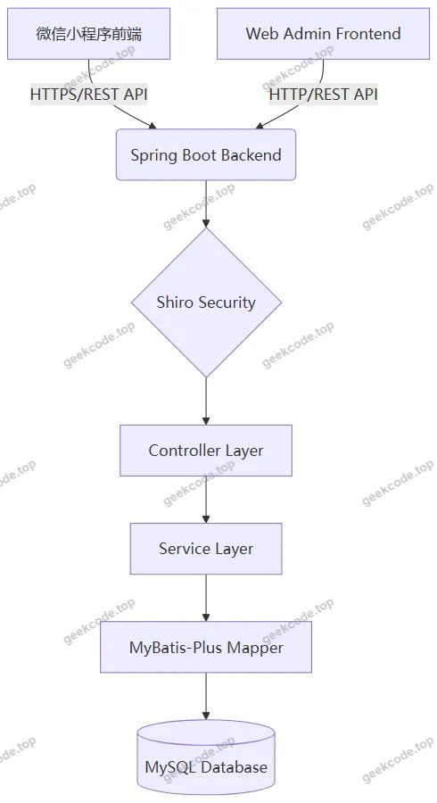</a>

<h2>功能模块</h2>

根据代码上下文中的 Controller 列表、后台路由及截图所示的小程序页面，系统功能划分为以下两个主要模块：

<h3>1. 小程序用户端功能</h3>

小程序端主要服务于毕业生用户，提供便捷的移动端操作体验：

<ul>
<li><strong>账户管理</strong>：</li>
<li><strong>注册/登录</strong>：支持新用户注册及现有用户登录。</li>
<li><strong>密码找回</strong>：提供忘记密码后的重置功能。</li>
<li><strong>个人信息</strong>：查看和编辑个人资料（userinfo）。</li>
<li><strong>求职招聘</strong>：</li>
<li><strong>首页概览</strong>：展示最新职位、热门公告等关键信息。</li>
<li><strong>职位浏览</strong>：查看详细的职位招聘信息（zhaopin）。</li>
<li><strong>公司信息</strong>：浏览入驻企业的详细介绍（gongsi）。</li>
<li><strong>职位收藏</strong>：将感兴趣的职位加入收藏夹，方便后续查看（zhaopinCollection）。</li>
<li><strong>职位留言</strong>：对特定职位进行咨询或留言互动（zhaopinLiuyan）。</li>
<li><strong>就业过程管理</strong>：</li>
<li><strong>面试申请</strong>：提交面试申请并查看申请状态（mianshishenqing）。</li>
<li><strong>就业晋升</strong>：记录入职后的晋升轨迹与信息（jinsheng）。</li>
<li><strong>工作评价</strong>：对工作经历或当前岗位进行评价反馈（gongzuopingjia）。</li>
<li><strong>资讯与交流</strong>：</li>
<li><strong>公告信息</strong>：接收学校或平台发布的就业相关通知（news）。</li>
<li><strong>论坛社区</strong>：参与话题讨论，分享求职经验（forum）。</li>
</ul>
<h3>2. Web 后台管理端功能</h3>

后台管理系统供管理员使用，侧重于数据维护、审核与系统配置：

<ul>
<li><strong>系统基础配置</strong>：</li>
<li><strong>管理员管理</strong>：添加、修改、删除后台管理员账号（users）。</li>
<li><strong>配置文件</strong>：管理系统全局参数（config）。</li>
<li><strong>备份与还原</strong>：提供数据备份（beifen）及恢复（huanyuan）功能，保障数据安全。</li>
<li><strong>业务数据管理</strong>：</li>
<li><strong>用户管理</strong>：维护毕业生用户信息（yonghu）。</li>
<li><strong>公司管理</strong>：审核及管理招聘企业信息（gongsi）。</li>
<li><strong>招聘管理</strong>：发布、编辑、下架招聘职位（zhaopin）。</li>
<li><strong>面试管理</strong>：审核用户的面试申请，更新申请状态（mianshishenqing）。</li>
<li><strong>评价管理</strong>：查看和管理用户提交的工作评价（gongzuopingjia）。</li>
<li><strong>晋升管理</strong>：录入和维护就业晋升信息（jinsheng）。</li>
<li><strong>内容与互动管理</strong>：</li>
<li><strong>新闻公告</strong>：发布和管理就业相关新闻资讯（news）。</li>
<li><strong>论坛管理</strong>：监控论坛帖子内容，维护社区秩序（forum）。</li>
<li><strong>留言管理</strong>：处理用户对职位的留言咨询（zhaopinLiuyan）。</li>
<li><strong>收藏管理</strong>：查看用户的职位收藏记录（zhaopinCollection）。</li>
<li><strong>字典数据维护</strong>：</li>
<li>管理各类下拉菜单选项，包括：性别（Sex）、上下架状态（Shangxia）、公司性质/类别（Gongsi）、面试结果状态（MianshishenqingYesno）、新闻分类（News）、招聘分类（Zhaopin）、论坛状态（ForumState）、收藏类型（ZhaopinCollection）等。</li>
</ul>
<h2>用户角色与权限</h2>

系统主要涉及两类用户角色，权限边界清晰：

<ol>
<li><strong>普通用户（毕业生）</strong>：</li>
</ol>
<ul>
<li><strong>接入端</strong>：微信小程序。</li>
<li><strong>权限范围</strong>：</li>
<li><strong>读权限</strong>：浏览所有公开的招聘信息、公司新闻、公告、论坛帖子及职位详情。</li>
<li><strong>写权限</strong>：注册账号、完善个人信息、投递简历/申请面试、收藏职位、发表职位留言、发布论坛帖子、提交工作评价、录入个人晋升信息。</li>
<li><strong>限制</strong>：无法访问后台管理功能，仅能操作与自己关联的数据（如自己的收藏、自己的面试申请状态查询）。</li>
</ul>
<ol start="2">
<li><strong>管理员</strong>：</li>
</ol>
<ul>
<li><strong>接入端</strong>：Web 浏览器（后台管理系统）。</li>
<li><strong>权限范围</strong>：</li>
<li><strong>超级权限</strong>：拥有对所有业务数据（用户、公司、职位、面试、评价、晋升、新闻、论坛、留言、收藏）的增删改查权限。</li>
<li><strong>系统维护</strong>：管理后台管理员账号、配置系统参数、执行数据备份与还原。</li>
<li><strong>字典管理</strong>：定义和维护系统中的基础数据字典（如性别、状态码等），直接影响前端展示选项。</li>
<li><strong>审核权</strong>：对用户提交的敏感信息或申请进行最终确认（如面试状态更新）。</li>
</ul>

<em>注：根据现有源码上下文，未提及“教师”或“企业HR”独立登录后台的角色，推测企业相关信息由管理员代为录入或由用户在小程序端自行维护后由管理员审核。</em>

<h2>项目特色与创新点</h2>
<ol>
<li>
<strong>全流程闭环管理</strong>：
   区别于传统仅关注“招聘-投递”阶段的系统，本项目延伸至“面试-入职-晋升-评价”全生命周期。通过 <code>jinsheng</code>（晋升）和 <code>gongzuopingjia</code>（工作评价）模块，不仅服务于求职，更关注学生毕业后的职业发展追踪，为高校就业指导提供更长周期的数据支撑。

</li>
<li>
<strong>灵活的字典驱动机制</strong>：
   后端设计了丰富的字典表（<code>dictionary</code> 系列），涵盖性别、状态、分类等多种维度。这种设计使得系统在不修改代码的前提下，可通过后台动态调整前端下拉选项和业务状态流转规则，极大地提升了系统的可配置性和扩展性。

</li>
<li>
<strong>多端协同与安全加固</strong>：
   采用微信小程序作为轻量级入口，降低用户使用门槛；后端引入 Shiro 框架进行细粒度的权限控制和会话管理，有效防止越权访问和数据泄露。同时，内置的数据备份（<code>beifen</code>）与还原（<code>huanyuan</code>）功能体现了对高校重要就业数据安全性的高度重视。

</li>
<li>
<strong>互动式就业服务</strong>：
   集成论坛（<code>forum</code>）和职位留言（<code>zhaopinLiuyan</code>）功能，构建了活跃的就业社区氛围。用户不仅可以单向获取信息，还能通过留言咨询和论坛发帖进行双向交流，增强了系统的粘性和实用性。

</li>
</ol>
<h2>部署环境</h2>

为确保系统正常运行，需准备以下软硬件环境：

<ol>
<li><strong>服务器端环境</strong>：</li>
</ol>
<ul>
<li><strong>操作系统</strong>：Windows 10/11, Linux (CentOS/Ubuntu), macOS。</li>
<li><strong>JDK 版本</strong>：Java Development Kit 8 或更高版本（推荐 JDK 1.8）。</li>
<li><strong>数据库</strong>：MySQL 5.7 或 MySQL 8.0。</li>
<li><strong>构建工具</strong>：Maven 3.x。</li>
</ul>
<ol start="2">
<li><strong>客户端/开发端环境</strong>：</li>
</ol>
<ul>
<li><strong>微信小程序</strong>：安装最新版“微信开发者工具”，用于小程序代码的编写、预览和调试。</li>
<li><strong>Web 浏览器</strong>：Chrome, Firefox, Edge 等主流浏览器，用于访问后台管理系统。</li>
</ul>
<ol start="3">
<li><strong>网络环境</strong>：</li>
</ol>
<ul>
<li>服务器需具备公网 IP 或内网穿透能力，以便微信小程序能够合法请求后端 API 接口（若上线正式版需配置 HTTPS 域名白名单）。</li>
</ul>
<h2>五、技术特性</h2>
<ul>
<li>前后端集成部署，前端资源打包至后端 static 目录</li>
<li>使用 MyBatis-Plus 简化数据访问层开发</li>
<li>集成 Shiro 权限框架实现角色权限控制</li>
</ul>
<h2>六、功能模块截图</h2>
<h3>微信小程序用户端</h3>

<figure><a href="https://geekcode.top/archives/%E5%9F%BA%E4%BA%8EJ2ee%E7%9A%84%E9%AB%98%E6%A0%A1%E6%AF%95%E4%B8%9A%E7%94%9F%E5%B0%B1%E4%B8%9A%E4%BF%A1%E6%81%AF%E7%B3%BB%E7%BB%9F%E5%B0%8F%E7%A8%8B%E5%BA%8Fpf?utm_source=github" title="查看完整源码">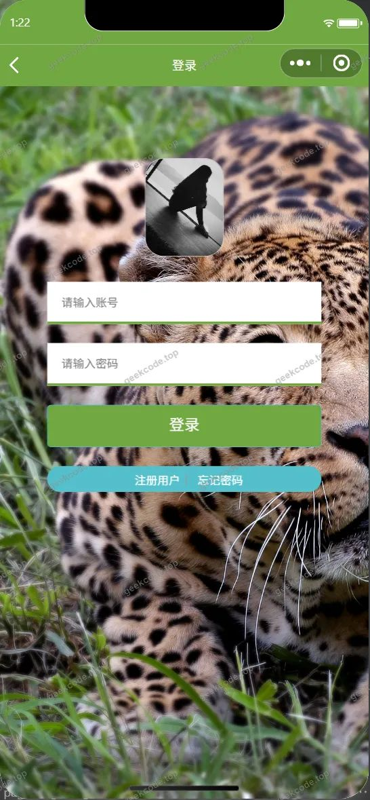</a><figcaption>小程序-登录</figcaption></figure>
<figure><a href="https://geekcode.top/archives/%E5%9F%BA%E4%BA%8EJ2ee%E7%9A%84%E9%AB%98%E6%A0%A1%E6%AF%95%E4%B8%9A%E7%94%9F%E5%B0%B1%E4%B8%9A%E4%BF%A1%E6%81%AF%E7%B3%BB%E7%BB%9F%E5%B0%8F%E7%A8%8B%E5%BA%8Fpf?utm_source=github" title="查看完整源码">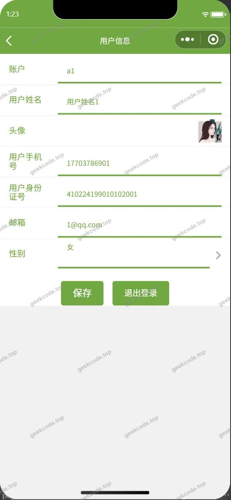</a><figcaption>小程序-个人信息userinfo</figcaption></figure>
<figure><a href="https://geekcode.top/archives/%E5%9F%BA%E4%BA%8EJ2ee%E7%9A%84%E9%AB%98%E6%A0%A1%E6%AF%95%E4%B8%9A%E7%94%9F%E5%B0%B1%E4%B8%9A%E4%BF%A1%E6%81%AF%E7%B3%BB%E7%BB%9F%E5%B0%8F%E7%A8%8B%E5%BA%8Fpf?utm_source=github" title="查看完整源码">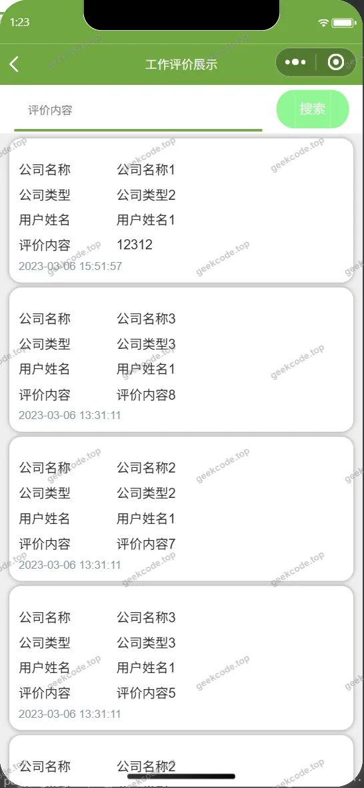</a><figcaption>小程序-工作评价列表</figcaption></figure>
<figure><a href="https://geekcode.top/archives/%E5%9F%BA%E4%BA%8EJ2ee%E7%9A%84%E9%AB%98%E6%A0%A1%E6%AF%95%E4%B8%9A%E7%94%9F%E5%B0%B1%E4%B8%9A%E4%BF%A1%E6%81%AF%E7%B3%BB%E7%BB%9F%E5%B0%8F%E7%A8%8B%E5%BA%8Fpf?utm_source=github" title="查看完整源码">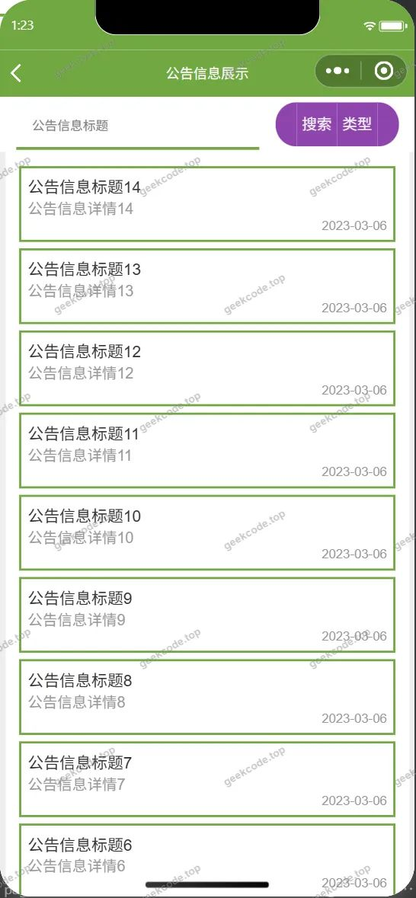</a><figcaption>小程序-公告信息列表</figcaption></figure>
<figure><figcaption>小程序-公司</figcaption></figure>
<figure><a href="https://geekcode.top/archives/%E5%9F%BA%E4%BA%8EJ2ee%E7%9A%84%E9%AB%98%E6%A0%A1%E6%AF%95%E4%B8%9A%E7%94%9F%E5%B0%B1%E4%B8%9A%E4%BF%A1%E6%81%AF%E7%B3%BB%E7%BB%9F%E5%B0%8F%E7%A8%8B%E5%BA%8Fpf?utm_source=github" title="查看完整源码">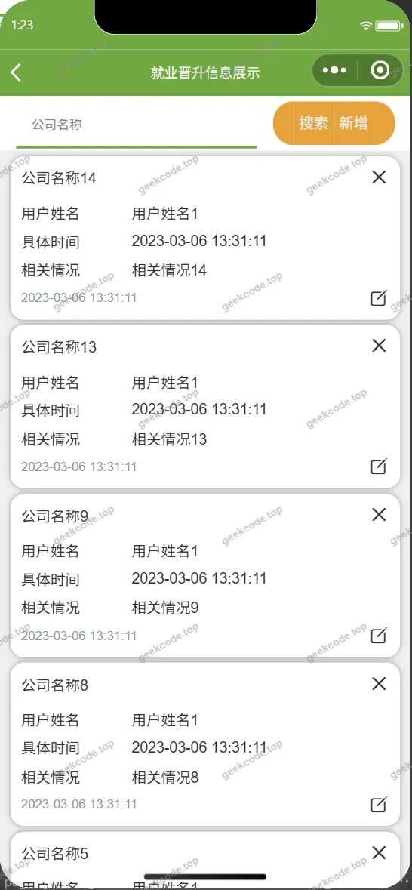</a><figcaption>小程序-就业晋升信息列表</figcaption></figure>
<figure><a href="https://geekcode.top/archives/%E5%9F%BA%E4%BA%8EJ2ee%E7%9A%84%E9%AB%98%E6%A0%A1%E6%AF%95%E4%B8%9A%E7%94%9F%E5%B0%B1%E4%B8%9A%E4%BF%A1%E6%81%AF%E7%B3%BB%E7%BB%9F%E5%B0%8F%E7%A8%8B%E5%BA%8Fpf?utm_source=github" title="查看完整源码">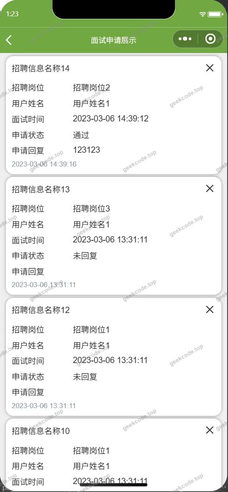</a><figcaption>小程序-面试申请列表</figcaption></figure>
<figure><a href="https://geekcode.top/archives/%E5%9F%BA%E4%BA%8EJ2ee%E7%9A%84%E9%AB%98%E6%A0%A1%E6%AF%95%E4%B8%9A%E7%94%9F%E5%B0%B1%E4%B8%9A%E4%BF%A1%E6%81%AF%E7%B3%BB%E7%BB%9F%E5%B0%8F%E7%A8%8B%E5%BA%8Fpf?utm_source=github" title="查看完整源码">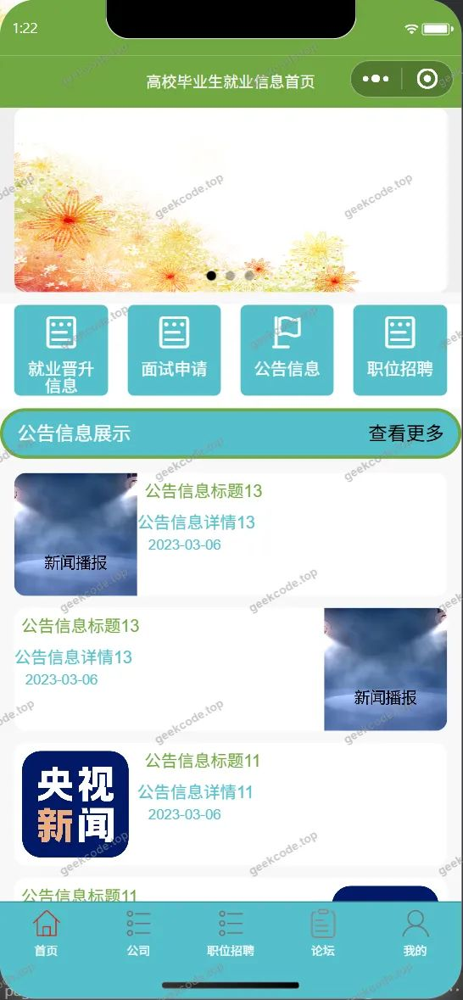</a><figcaption>小程序-首页</figcaption></figure>
<figure><figcaption>小程序-忘记密码</figcaption></figure>
<figure><a href="https://geekcode.top/archives/%E5%9F%BA%E4%BA%8EJ2ee%E7%9A%84%E9%AB%98%E6%A0%A1%E6%AF%95%E4%B8%9A%E7%94%9F%E5%B0%B1%E4%B8%9A%E4%BF%A1%E6%81%AF%E7%B3%BB%E7%BB%9F%E5%B0%8F%E7%A8%8B%E5%BA%8Fpf?utm_source=github" title="查看完整源码">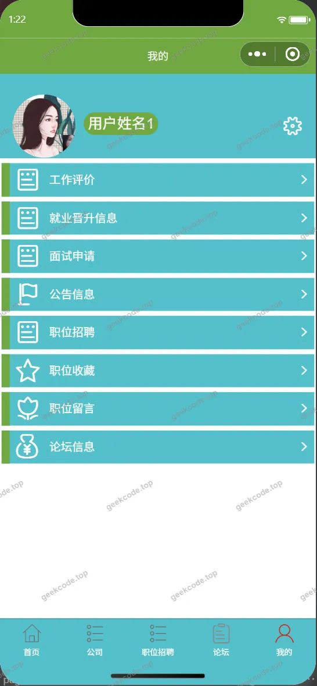</a><figcaption>小程序-我的</figcaption></figure>
<figure><figcaption>小程序-职位留言列表</figcaption></figure>
<figure><figcaption>小程序-职位收藏列表</figcaption></figure>
<figure><figcaption>小程序-职位招聘</figcaption></figure>
<figure><a href="https://geekcode.top/archives/%E5%9F%BA%E4%BA%8EJ2ee%E7%9A%84%E9%AB%98%E6%A0%A1%E6%AF%95%E4%B8%9A%E7%94%9F%E5%B0%B1%E4%B8%9A%E4%BF%A1%E6%81%AF%E7%B3%BB%E7%BB%9F%E5%B0%8F%E7%A8%8B%E5%BA%8Fpf?utm_source=github" title="查看完整源码">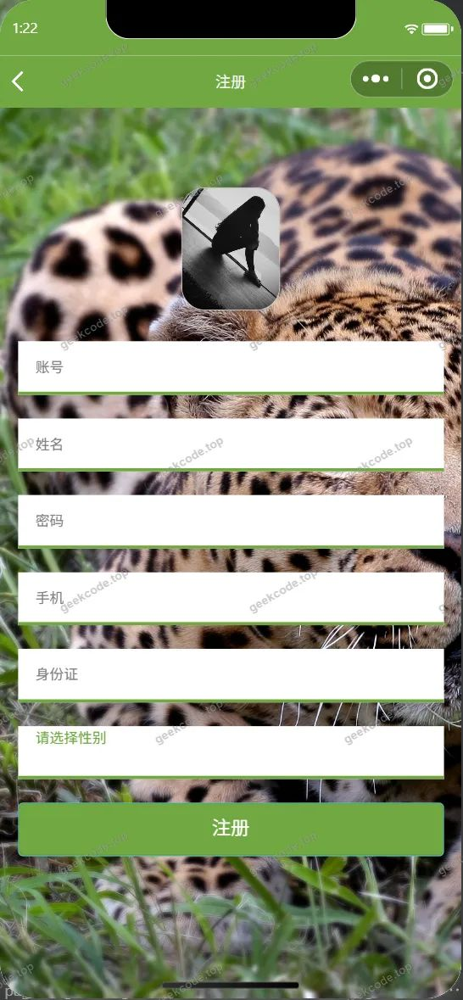</a><figcaption>小程序-注册</figcaption></figure>

<h3>后台管理端</h3>
<h4>后台-登录页</h4>

<h4>后台-工作评价</h4>

<a href="https://geekcode.top/archives/%E5%9F%BA%E4%BA%8EJ2ee%E7%9A%84%E9%AB%98%E6%A0%A1%E6%AF%95%E4%B8%9A%E7%94%9F%E5%B0%B1%E4%B8%9A%E4%BF%A1%E6%81%AF%E7%B3%BB%E7%BB%9F%E5%B0%8F%E7%A8%8B%E5%BA%8Fpf?utm_source=github" title="查看完整源码">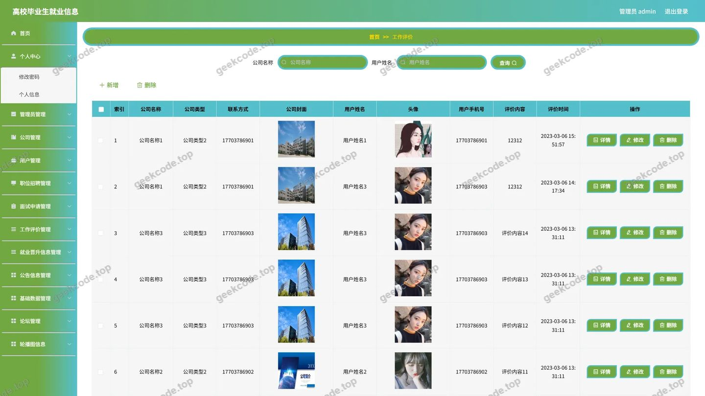</a>

<h4>后台-公司</h4>

<a href="https://geekcode.top/archives/%E5%9F%BA%E4%BA%8EJ2ee%E7%9A%84%E9%AB%98%E6%A0%A1%E6%AF%95%E4%B8%9A%E7%94%9F%E5%B0%B1%E4%B8%9A%E4%BF%A1%E6%81%AF%E7%B3%BB%E7%BB%9F%E5%B0%8F%E7%A8%8B%E5%BA%8Fpf?utm_source=github" title="查看完整源码">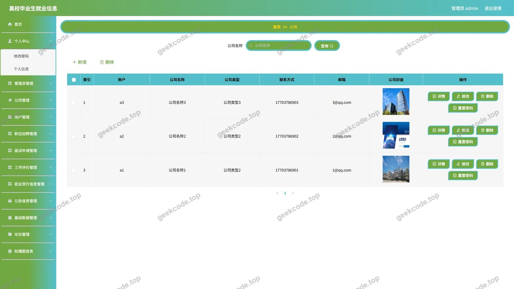</a>

<h4>后台-管理员</h4>

<a href="https://geekcode.top/archives/%E5%9F%BA%E4%BA%8EJ2ee%E7%9A%84%E9%AB%98%E6%A0%A1%E6%AF%95%E4%B8%9A%E7%94%9F%E5%B0%B1%E4%B8%9A%E4%BF%A1%E6%81%AF%E7%B3%BB%E7%BB%9F%E5%B0%8F%E7%A8%8B%E5%BA%8Fpf?utm_source=github" title="查看完整源码">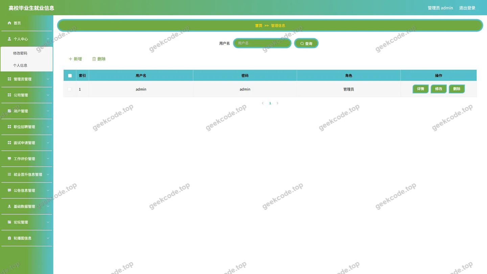</a>

<h4>后台-就业晋升信息</h4>

<a href="https://geekcode.top/archives/%E5%9F%BA%E4%BA%8EJ2ee%E7%9A%84%E9%AB%98%E6%A0%A1%E6%AF%95%E4%B8%9A%E7%94%9F%E5%B0%B1%E4%B8%9A%E4%BF%A1%E6%81%AF%E7%B3%BB%E7%BB%9F%E5%B0%8F%E7%A8%8B%E5%BA%8Fpf?utm_source=github" title="查看完整源码">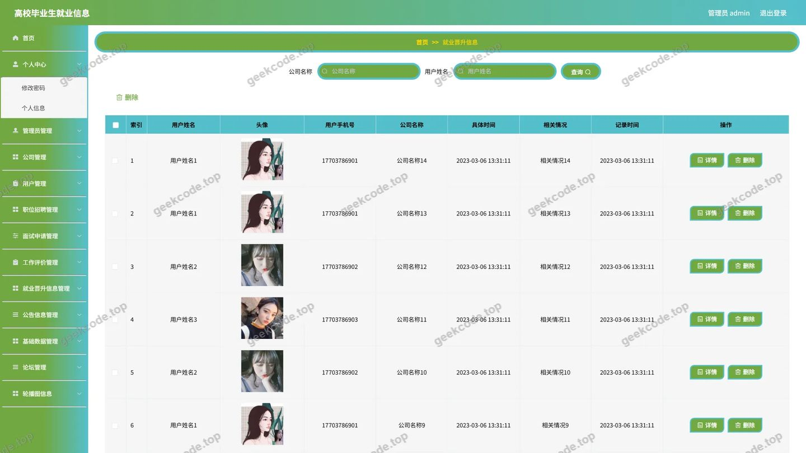</a>

<h4>后台-面试申请</h4>

<h4>后台-配置文件</h4>

<a href="https://geekcode.top/archives/%E5%9F%BA%E4%BA%8EJ2ee%E7%9A%84%E9%AB%98%E6%A0%A1%E6%AF%95%E4%B8%9A%E7%94%9F%E5%B0%B1%E4%B8%9A%E4%BF%A1%E6%81%AF%E7%B3%BB%E7%BB%9F%E5%B0%8F%E7%A8%8B%E5%BA%8Fpf?utm_source=github" title="查看完整源码">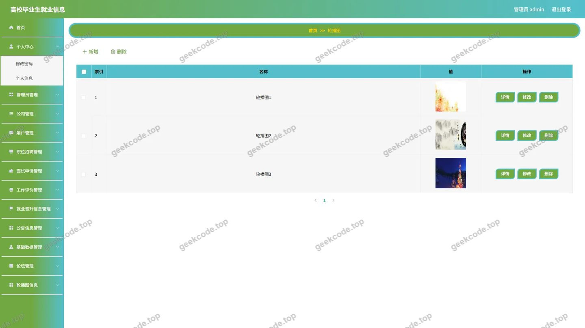</a>

<h4>后台首页</h4>

<a href="https://geekcode.top/archives/%E5%9F%BA%E4%BA%8EJ2ee%E7%9A%84%E9%AB%98%E6%A0%A1%E6%AF%95%E4%B8%9A%E7%94%9F%E5%B0%B1%E4%B8%9A%E4%BF%A1%E6%81%AF%E7%B3%BB%E7%BB%9F%E5%B0%8F%E7%A8%8B%E5%BA%8Fpf?utm_source=github" title="查看完整源码">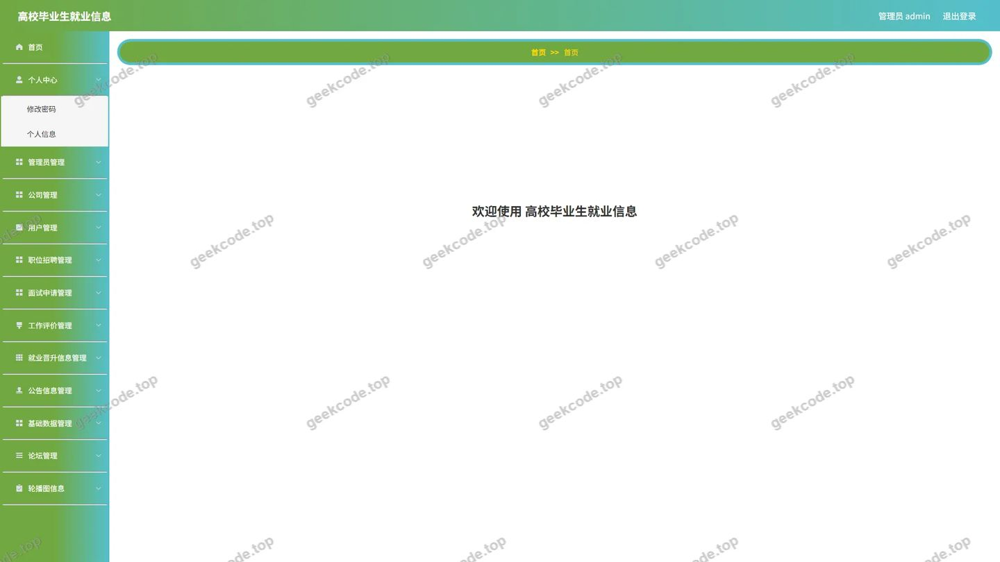</a>

---

## 获取完整源码

| 项目 | 说明 |
| --- | --- |
| 项目名 | 基于J2ee的高校毕业生就业信息系统小程序pf |
| 运行截图 | 本文 23 张（站点带水印原图，仓库 `images/` 目录） |
| 完整源码 | [https://geekcode.top/archives/%E5%9F%BA%E4%BA%8EJ2ee%E7%9A%84%E9%AB%98%E6%A0%A1%E6%AF%95%E4%B8%9A%E7%94%9F%E5%B0%B1%E4%B8%9A%E4%BF%A1%E6%81%AF%E7%B3%BB%E7%BB%9F%E5%B0%8F%E7%A8%8B%E5%BA%8Fpf?utm_source=github](https://geekcode.top/archives/%E5%9F%BA%E4%BA%8EJ2ee%E7%9A%84%E9%AB%98%E6%A0%A1%E6%AF%95%E4%B8%9A%E7%94%9F%E5%B0%B1%E4%B8%9A%E4%BF%A1%E6%81%AF%E7%B3%BB%E7%BB%9F%E5%B0%8F%E7%A8%8B%E5%BA%8Fpf?utm_source=github) |
| 咨询微信 | **ir9372**（备注：jingpin-yuanma） |
| 更多项目 | [极客代码 geekcode.top](https://geekcode.top/?utm_source=github) |

> 需要源码、部署、改配置、跑不起来等问题，加微信 ir9372 沟通，说明项目名即可。
